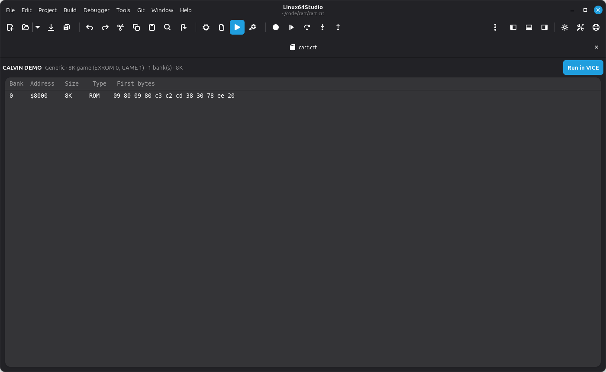

# Cartridges (.crt)

In **Project Properties → Cartridge**, switch on *Write a cartridge* and pick a type. Every
whole-project build then writes a `.crt` next to the `.prg`. With *Run with the cartridge
plugged in*, Ctrl+F5 and debugging start VICE with the cartridge attached (`-cartcrt`).



**New → Project → Cartridge, 8K** makes a project with a working 8K cartridge to start from.

## Types

| Type | Bank 0 is assembled at | Banks | Notes |
|---|---|---|---|
| Normal 8K | `$8000-$9FFF` | 1 | EXROM 0, GAME 1. Needs a CBM80 header |
| Normal 16K | `$8000-$BFFF` | 1 | EXROM 0, GAME 0 |
| Ultimax | `$E000-$FFFF` (or `$F000` for 4K), plus optional `$8000-$9FFF` | 1 | Boots from the reset vector at `$FFFC`. Only `$0000-$0FFF` is RAM |
| Magic Desk | `$8000-$9FFF` | 4–64 (32K–512K) | Bank number to `$DE00` |
| Ocean type 1 | `$8000-$9FFF` | 16, 32 or 64 (128K/256K/512K) | Bank number + `$80` to `$DE00`. In a 256K cart banks 16–31 sit at `$A000`. 512K runs in 8K mode |
| EasyFlash | ROML `$8000-$9FFF`, ROMH `$E000-$FFFF` | up to 64 × 16K (1MB) | Boots in Ultimax mode from bank 0's ROMH. Bank to `$DE00`, mode to `$DE02` |

Normal and Magic Desk/Ocean cartridges start through the **CBM80** signature:

```
*=$8000
        word coldStart, warmStart
        byte $C3, $C2, $CD, $38, $30    ; "CBM80"
```

If the program has anything outside the cartridge's ROM area (a BASIC loader at `$0801`, say),
the build fails and says where. Unused ROM is filled with `$FF`, as an erased EPROM or flash
chip is.

## More banks

For Magic Desk, Ocean and EasyFlash, list data files under *Banks 1, 2, …*. They're split
into 8K banks (16K for EasyFlash: ROML, then ROMH) and follow bank 0 in order. A `.prg`'s load
address is dropped. Magic Desk and Ocean are padded to a real cartridge size. EasyFlash chips
that are entirely `$FF` are left out of the file, as `cartconv` does.

## Command line

```sh
l64cart make normal8 cart.prg -o game.crt --name "MY GAME"
l64cart make ocean boot.prg --bank levels.bin --bank music.bin -o game.crt
l64cart info game.crt
l64asm cart.asm --crt normal8          # writes cart.prg and cart.crt
```

## Checks

`tests/test_cart.py` checks every type and size byte for byte against VICE's `cartconv` on the
same data. Each type has also been booted in VICE (x64sc 3.7.1). The bank-switched types
switched to bank 1 and read back a marker byte, which checks that the extra banks are numbered
and mapped correctly.

CBM prg Studio projects that build a generic cartridge (`<CrtBuildingCartridge>` with its
EXROM/GAME settings) open with the matching 8K, 16K or Ultimax type set.
