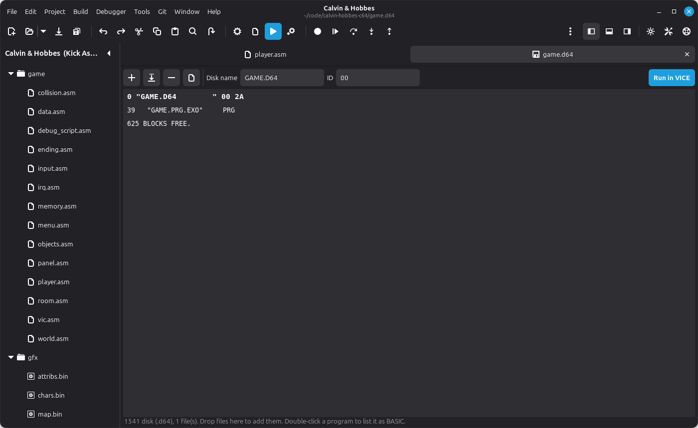

# Disk images (.d64, .d71, .d81)

| Format | Drive | Tracks | Blocks free | Directory |
|---|---|---|---|---|
| `.d64` | 1541 | 35 | 664 | track 18 |
| `.d71` | 1571 (double-sided) | 70 | 1328 | track 18 (side two's BAM on track 53) |
| `.d81` | 1581 (3½") | 80 × 40 sectors | 3160 | track 40 |

The format is chosen by the file extension.

## From a project

In **Project Properties → Disk Image**, switch on *Write a disk image* and pick the format. Every whole-project
build (F7, Ctrl+F5) then writes the `.d64` after the `.prg`. Building just the current file
doesn't.

* **Image file**: where to write it, relative to the project.
* **Made by a post-build command**: for a disk that something else builds, such as a Makefile
  calling `cc1541` for a fast loader's sector layout. Linux64Studio never writes the image file,
  and uses it for Run and Debug as the [build events](dialect.md) leave it. The disk name, ID,
  program and extra files settings don't apply. If the file isn't there after the commands have
  run, the build fails.
* **Disk name / ID**: the header that `LOAD"$",8` shows (16 and 2 characters).
* **Program's name on the disk**: defaults to the `.prg`'s name, so `LOAD"GAME",8,1` works.
* **More files on the disk**: other programs or data files, written after the program.
  `.prg` files go on as PRG, `.seq` as SEQ, `.usr` as USR. A `.bin` goes on as PRG, so it
  should already start with its load address.
* **Run from the disk image**: Ctrl+F5 and debugging autostart the `.d64` instead of the
  `.prg`, like running it from a real disk. VICE's drive 8 is set to a 1571 or 1581 for
  `.d71` and `.d81` images.

If the disk is full or an extra file is missing, the build fails with an error in the build
output.

## Opening a .d64

Disk images open in a directory view, the way `LOAD"$",8` shows it. You can add files (or
drag them in), extract them, delete them, change the disk name and ID, list a program as BASIC
(double-click it), and run the disk in VICE. Ctrl+S saves the image.



## Command line

```sh
l64disk create game.d64 "my game,mg" game.prg hiscores.seq
l64disk create big.d81 "big game,bg" game.prg level*.prg
l64disk list game.d64
l64disk add game.d64 level2.prg --name "LEVEL 2"
l64disk extract game.d64 "level 2" -o level2.prg
l64disk delete game.d64 "level 2"
l64asm game.asm --d64 game.d64 --disk-name "my game,mg"
l64bas game.bas --d64 game.d64
```

## How files are laid out

Files are allocated exactly as each drive's DOS does it. The algorithm comes from Rift64's
drive emulation:

* A new file starts at the first free sector on the track nearest the directory (17, 19,
  16, 20, … on a 1541 or 1571; 39, 41, 38, … on a 1581).
* Each further block is the drive's interleave on: 10 sectors on a 1541, 6 on a 1571, 1 on
  a 1581. Past the end of a track it wraps round one short.
* When a track is full, allocation carries on away from the directory, and when that side
  of the disk is full, it starts again from the other side. On a 1571 that means side two
  (tracks 36–70) follows track 35.
* Directory sectors are chained 3 apart on a 1541/1571, and 1 apart on a 1581.
* When a file exactly fills its last sector, the DOS takes one more block that no file uses.
  A finished image is validated, as with `V`, so that block is given back.

`tests/test_disk_images.py` replays experiments recorded on real 1541, 1571 and 1581 drives
(formatting, saving files, scratching some, validating). For each drive, every file's sector
chain, the free count and the whole BAM must come out line for line the same. VICE's `c1541`
also reads all three formats, and writing more files to them with `c1541` leaves the existing
ones intact.
