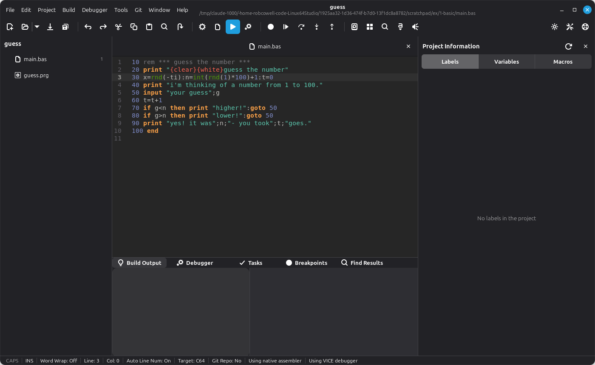
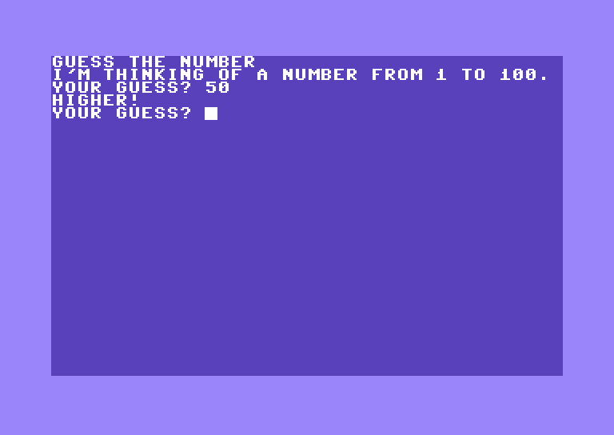

# Your first BASIC program

<!-- example: 1-basic -->

You'll write a number-guessing game in BASIC V2, the C64's own BASIC, then build it and run it in
VICE. It takes about five minutes.

## Make a project

1. **File → New → Project…**
2. Name it `guess`, and choose **BASIC V2** as its type. The project goes in a folder of its own
   under the location shown (`~/c64` unless you choose another).
3. Press **Create**.

The project opens with `main.bas`, a starter program that already works. Press **Ctrl+F5** (Build
Project and Run) to try it: VICE starts, loads the program and runs it, printing *hello, world!*
with the border flashing. Close VICE's window when you've seen it.

## Write the game

Select everything in `main.bas` (**Ctrl+A**) and type this instead:

```
10 rem *** guess the number ***
20 print "{clear}{white}guess the number"
30 x=rnd(-ti):n=int(rnd(1)*100)+1:t=0
40 print "i'm thinking of a number from 1 to 100."
50 input "your guess";g
60 t=t+1
70 if g<n then print "higher!":goto 50
80 if g>n then print "lower!":goto 50
90 print "yes! it was";n;"- you took";t;"goes."
100 end
```



A few things about how BASIC is written here:

* **Keywords are in lower case.** This is listing notation, as the books print programs. On the
  C64's start-up screen, lower-case letters show as capitals. Capitals in the source are the
  shifted characters, the graphics on the keys, and wouldn't be read as keywords.
* **`{clear}` and `{white}` are control codes**: what you'd type on a C64 with CLR/HOME and
  CTRL+2 inside quote marks. `{clear}` clears the screen and `{white}` changes the text colour.
* **Line numbers come by themselves.** Press Return at the end of a numbered line and the next
  number is typed for you, in steps of 10.

## Run it

Press **Ctrl+F5**. The program is built (turned into the C64's tokens, as typing it in would do),
VICE starts and runs it. Type a guess and press Return. The program tells you to go higher or
lower until you get it.



If a line has a mistake that BASIC can't tokenize, the build stops and **Build Output** at the
bottom of the window says where. Click the message to go to the line.

## Look up a keyword

Hover the mouse over a keyword, `rnd` say, for what it does. For more, put the cursor on it and
press **F1**: the **BASIC Keywords** tab opens at it, with an example and how to abbreviate it.

Line 30 is worth a look: `rnd(-ti)` starts the random numbers from the clock (TI), so each run
picks a different number, and `int(rnd(1)*100)+1` makes a whole number from 1 to 100.

## Try next

* Count the guesses down from 7, and end the game when they run out.
* Ask *play again?* at the end, and `goto 30` if the answer is `y`.

Next: [your first assembler program](2-assembler.md).
