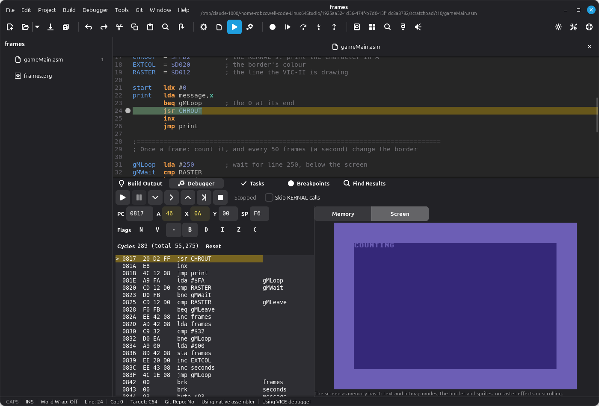

# Debugging without VICE

<!-- example: 10-simulator -->

You'll debug a program without starting an emulator, on the C64 that Linux64Studio simulates
itself, as CBM prg Studio's own debugger does. Then you'll run its transcript the same way, which
is how tests can run on a machine with no screen. It takes about ten minutes.

## The program

Make an assembler project called `frames` (**File → New → Project…**), and replace everything
below the BASIC loader in `gameMain.asm` with this:

```
CHROUT  = $FFD2         ; the KERNAL's: print the character in A
EXTCOL  = $D020         ; the border's colour
RASTER  = $D012         ; the line the VIC-II is drawing

start   ldx #0
print   lda message,x
        beq gMLoop      ; the 0 at its end
        jsr CHROUT
        inx
        jmp print

gMLoop  lda #250        ; wait for line 250, below the screen
gMWait  cmp RASTER
        bne gMWait
gMLeave cmp RASTER      ; then for it to end
        beq gMLeave
        inc frames
        lda frames
        cmp #50
        bne gMLoop
        lda #0
        sta frames
        inc EXTCOL
        inc seconds
        jmp gMLoop

frames  byte 0
seconds byte 0
message byte 147        ; {clear}
        text "counting frames by the raster line."
        byte 0
```

It prints a message with the KERNAL's `CHROUT`, then counts frames by waiting for the raster line,
and every 50 frames (a second, on a PAL C64) moves the border on a colour. Press **Ctrl+F5** to see
it in VICE first.

## Debug it on the simulator

Press **Ctrl+Shift+F5**, or **Debugger → Debug Without VICE (simulator)**. No VICE window opens.
The **Debugger** tab says *Running*, and beside the memory it has a **Screen**: the message, and a
border that changes colour every second.

The simulated C64 starts as a real one does. The KERNAL (VICE's copy of the real ROM) boots to READY,
the program is loaded, and `RUN` is typed. So `CHROUT` really runs: the message is printed by the
same ROM code as on a C64.

1. Put a breakpoint on `inc EXTCOL` (click its line number). The program stops there after a
   second. **Cycles** shows how long the run took, every cycle counted: about a million, a second's
   worth on a PAL C64.
2. Press **F11** to run `inc EXTCOL`. The Screen's border changes colour, from the line the raster
   had reached down: the Screen is drawn a line at a time, as the VIC-II draws it.
3. Remove the breakpoint and put one on `jsr CHROUT`. Click **Stop debugging**, then press
   **Ctrl+Shift+F5** again: it stops before the first character is printed.
4. Press **F10** (Step Over) to run the whole `CHROUT` call. The first character is 147, `{clear}`,
   and **Cycles** shows what clearing the screen cost, the KERNAL's code included: about 38,000
   cycles, nearly two frames. Then press **F8** (Continue) a few times. It stops at `jsr CHROUT` for
   each character, about 290 cycles apart, and the message appears on the Screen a letter at a time.
   Drag the divider above the Debugger tab up to make the Screen bigger.



## What it simulates, and what it doesn't

The 6510 is simulated exactly, cycle for cycle, with the C64's memory and its ROMs. The raster line
counts as on a real C64 (63 cycles a line, 312 lines a frame), so waiting for line 250 works. The
VIC-II, SID and CIAs mostly aren't simulated: their registers are just memory. But the VIC-II's
raster interrupt and CIA 1's timer are, so interrupts happen as on a C64: the KERNAL's own, 60 times
a second, and any a program sets up. A step never goes into one, though: **F11** runs the
instruction at the PC, and the interrupt waits until the program runs on.

When the project writes a disk image, it's in the simulator's drive 8, so LOAD, SAVE and files
opened with OPEN work as with a 1541 (as in [tutorial 8](8-disk.md)). What the program writes stays
in the simulator: the project's disk image isn't changed.

That makes it good for logic: tables, maths, game rules, what a routine leaves in memory, and the
timing of a main loop or an interrupt, with the cycles the VIC-II takes for badlines and sprites
counted as on a C64. Code that needs the real chips needs VICE: sound you can hear, for one. The Screen is close to a C64's: it's drawn a line at a time, with
the registers and screen memory each line had, and it matches VICE's picture for text, bitmaps,
scrolling, sprites and the border. **Skip KERNAL calls**, in the Debugger tab's bar, steps over KERNAL calls
without running them, as in CBM prg Studio.

It runs at a real C64's speed. Click the Screen and the keyboard is the C64's, with the arrow keys
as joystick 2 (keypad 0 or Right Ctrl fires), so a game can be played there. **Full speed** in the
Debugger tab's bar runs it as fast as it goes, to get to a breakpoint sooner. **Debugger → Snapshots**
saves the simulated machine at any moment, to come back to it later.

## Tests without VICE

Make a transcript (**File → New → Transcript (tests)…**, `tests.transcript`) with:

```
run until gMLoop
check $0400 = "counting frames"
check seconds = 0
wait 2
check seconds >= 1
check seconds <= 2
```

Choose **Debugger → Run Transcript Without VICE**. It runs on the simulator, and the results come
up in **Build Output** in a moment. `wait 2` is two seconds of the C64's own time there, so
`seconds` is exactly 2. In VICE (**Run Transcript**), `wait` is two seconds on the clock on the
wall, which is why the checks allow a second either way.

From a terminal, `l64test --simulate frames.l64proj tests.transcript` does the same, with no window
at all. That's how tests can run on a build server, or every time you commit.

## Try next

* Debug [the flash program](2-assembler.md) without VICE, and step through `flash`: its cycle
  counts are the same as VICE's, down to the last cycle.
* Change `cmp #50` to `cmp #25` and see the border change twice a second.
* On the simulator, a transcript can move the joystick and hold keys: `joystick 2 right fire`, then
  `wait 1` and check where the player got to; `hold space`, `release`. That's a game's controls
  tested with no one at the keyboard.

That's the last tutorial. The Retro Game Dev books carry on from here: open a chapter's `.cbmprj`
with **File → Open Project**.
