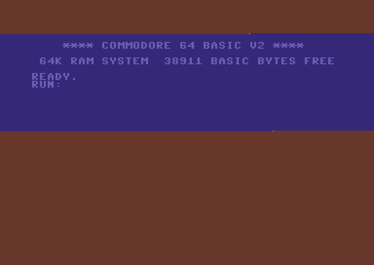
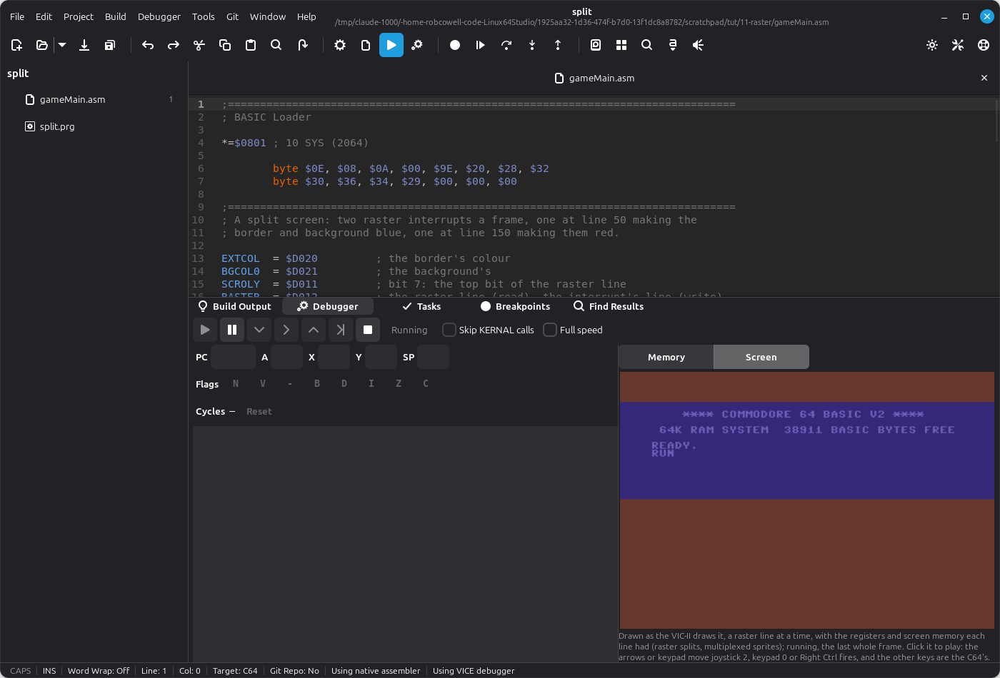

# Raster interrupts

<!-- example: 11-raster -->

The VIC-II draws the screen a line at a time, 50 times a second, and it can interrupt the 6510 when
it reaches a line you choose. Games use this to change things partway down the screen: a different
colour, a scrolling area, more sprites. You'll split the screen into red and blue with two raster
interrupts. It takes about fifteen minutes.

## The program

Make an assembler project called `split` (**File → New → Project…**). Replace everything below the
BASIC loader in `gameMain.asm` with this:

```
EXTCOL  = $D020         ; the border's colour
BGCOL0  = $D021         ; the background's
SCROLY  = $D011         ; bit 7: the top bit of the raster line
RASTER  = $D012         ; the raster line (read), the interrupt's line (write)
VICIRQ  = $D019         ; the VIC-II's interrupt flags (write 1 to clear)
IRQMSK  = $D01A         ; which of them interrupt
CIAICR  = $DC0D         ; CIA 1's interrupt control
CINV    = $0314         ; where the KERNAL's interrupt goes on to
TOP     = 50            ; the split's lines
MIDDLE  = 150

start   sei             ; no interrupts while they're set up
        lda #$7f        ; CIA 1's timer: no more interrupts from it
        sta CIAICR
        lda CIAICR      ; (one waiting is cleared by reading)
        lda #<irqTop    ; the first handler
        sta CINV
        lda #>irqTop
        sta CINV+1
        lda #TOP        ; at line 50
        sta RASTER
        lda SCROLY      ; (lines below 256: bit 7 clear)
        and #$7f
        sta SCROLY
        lda #1          ; raster interrupts on
        sta IRQMSK
        cli

gMLoop  jmp gMLoop      ; the main program: nothing, here

irqTop  lda #6          ; blue from line 50
        sta EXTCOL
        sta BGCOL0
        lda #<irqMiddle ; the next interrupt: the other handler, at line 150
        sta CINV
        lda #>irqMiddle
        sta CINV+1
        lda #MIDDLE
        sta RASTER
        inc frames      ; (a count of frames, to test)
        lda #1          ; acknowledge it
        sta VICIRQ
        jmp $EA31       ; the KERNAL's own work, once a frame: keys, its clock

irqMiddle lda #2        ; red from line 150
        sta EXTCOL
        sta BGCOL0
        lda #<irqTop
        sta CINV
        lda #>irqTop
        sta CINV+1
        lda #TOP
        sta RASTER
        lda #1
        sta VICIRQ
        jmp $EA81       ; back to the program

frames  byte 0
```

Press **Ctrl+F5**. The screen is blue from line 50 to line 150 and red elsewhere, and the program
itself is doing nothing at all: the interrupts do all the work.



How it works:

* **Setting up.** `sei` stops interrupts until everything's ready, and `cli` lets them start. The
  KERNAL's own interrupt, 60 times a second, comes from CIA 1's timer. Writing `$7f` to `$DC0D`
  switches that off, so the only interrupts now are the VIC-II's.
* **Where the handler is.** When an interrupt comes, the 6510 jumps through the vector at `$FFFE` to
  the KERNAL. The KERNAL saves the registers and jumps on through `$0314`, which is where we put our
  handler.
* **Which line.** `$D012` says the line to interrupt on, and `$D011`'s top bit is the line's ninth
  bit (the PAL screen has 312 lines). `$D01A` = 1 turns the raster interrupt on.
* **Two handlers, taking turns.** Each handler changes the colours, then sets up the other one: the
  next line and the next address in `$0314`. So the VIC-II interrupts at line 50, then 150, then 50
  again in the next frame.
* **Acknowledging.** Writing 1 to `$D019` clears the interrupt's flag. Without it, the interrupt
  happens again the moment the handler returns.
* **Returning.** `$EA81` is the end of the KERNAL's handler: it puts the registers back and returns
  to the program. `$EA31` is its beginning, which reads the keyboard and ticks the clock first: once a
  frame is enough for that.
* `TOP` and `irqTop` have different names because labels are the same whatever their case.

## Watch it without VICE

Press **Ctrl+Shift+F5** (**Debug Without VICE**) and click **Screen** in the Debugger tab. The
simulated C64 draws the screen a line at a time, with the registers each line had, so the split shows
there too.



Click in the gutter beside `irqMiddle` to set a breakpoint: the program stops in the handler, with the
**Cycles** counter showing how long since it last stopped. Press **F8** to carry on: it stops there
once a frame, about every 19,656 cycles (a few more or less: **Try next** says why).

## Test it

The example's transcript checks that both handlers run:

```
run until gMLoop
check $d01a & $0f = $01           ; raster interrupts on (the bits it hasn't got read as 1)
wait 1
check frames >= #45               ; a second: 50 frames
until irqMiddle                   ; the handler for line 150
check $d012 = #150
until irqTop                      ; and the one for line 50
check $d012 = #50
```

`until` lets the program run on until it reaches the label, interrupts included.

## Try next

* Look closely at the line where the colour changes: its left end wobbles by a few pixels from
  frame to frame. The 6510 finishes the instruction it's running before it takes an interrupt, and
  instructions take 2 to 7 cycles, so the handler starts a little later some frames than others. The
  usual cure is a second interrupt a line later, from inside the first, which starts at a known
  cycle (a "stable raster").
* Add a third split at line 200, with its own colour.
* Make the main program do something: `inc $0400` in the loop, say. The interrupts carry on anyway.

Next: [a scrolling message](12-scroll.md).
