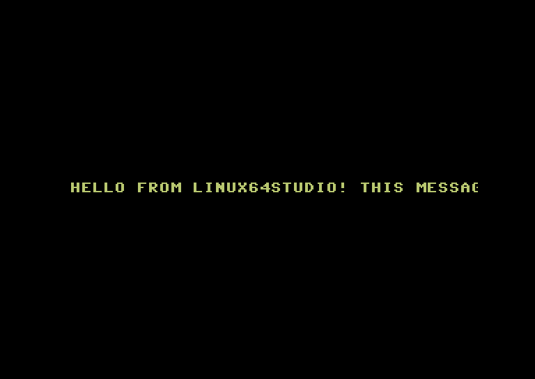

# A scrolling message

<!-- example: 12-scroll -->

The C64's screen is made of characters, but it can scroll smoothly: the VIC-II can shift the whole
picture up to 7 pixels sideways. Shift it a pixel a frame, and every 8 pixels move the characters one
place along, and the text glides. You'll make a message scroll across the screen. It takes about ten
minutes.

## The program

Make an assembler project called `scroller`, and replace everything below the BASIC loader in
`gameMain.asm` with this:

```
EXTCOL  = $D020         ; the border's colour
BGCOL0  = $D021         ; the background's
RASTER  = $D012         ; the raster line
SCROLX  = $D016         ; bits 0-2: the fine scroll across; bit 3: 40 columns (1) or 38
CLEAR   = $E544         ; the KERNAL's screen clear
ROW     = $0400+12*40   ; row 12 of the screen
ROWCOL  = $D800+12*40   ; and its colours

start   jsr CLEAR
        lda #0          ; black
        sta EXTCOL
        sta BGCOL0
        lda #7          ; the row in yellow
        ldx #39
@colour sta ROWCOL,x
        dex
        bpl @colour

frame   lda #250        ; wait for line 250, below the text
@wait   cmp RASTER
        bne @wait
        dec fine        ; one pixel further left
        bpl setScroll
        lda #7          ; 8 pixels gone: back to 7, and the row moves a whole
        sta fine        ; character left
        jsr shift
setScroll lda fine
        ora #%11000000  ; 38 columns (bit 3 clear), so the edges are hidden
        sta SCROLX
        jmp frame

shift   ldx #0          ; each character one place left
@move   lda ROW+1,x
        sta ROW,x
        inx
        cpx #39
        bne @move
        ldy next        ; and the message's next letter on the right
        lda message,y
        bne @put
        ldy #0          ; (at its end, back to the start)
        lda message
@put    sta ROW+39
        iny
        sty next
        rts

fine    byte 7          ; the fine scroll: 7 to 0
next    byte 0          ; the message's next letter
message text 'hello from linux64studio! this message scrolls a pixel at a time ...    '
        byte 0
```

Press **Ctrl+F5**, and the message glides in from the right.



How it works:

* **Once a frame.** The loop waits for raster line 250, below the text, so each change happens while
  the VIC-II isn't drawing the row: the text never tears. The VIC-II draws 50 frames a second, so the
  text moves 50 pixels a second.
* **The fine scroll.** `$D016`'s bottom three bits shift the picture right by 0 to 7 pixels. Counting
  `fine` down from 7 to 0 moves the text left a pixel a frame.
* **The coarse scroll.** After 8 pixels, `fine` goes back to 7 and `shift` moves the row's characters
  one place left, so the picture is back where it started, a character on. The message's next letter
  comes in at the right.
* **38 columns.** With bit 3 of `$D016` clear, the border covers the first and last columns, so the
  letters appear and disappear under it rather than jumping in at the edge.
* **Screen codes.** `text '...'`, with single quotes, gives screen codes, which go straight into
  screen memory (`'a'` is 1). With double quotes it would give PETSCII, for printing with `CHROUT`.
* `ROW` and `ROWCOL` are worked out by the assembler: row 12 starts 12 × 40 characters into the
  screen.

## Watch it scroll a pixel at a time

Set a breakpoint on `dec fine` and debug it (**F5**, or **Ctrl+Shift+F5** without VICE). Each **F8**
is one frame: watch `fine` count down in **Memory** (type `fine` in its address box), and on the
simulator's **Screen** the text moves one pixel each time.

## Test it

```
run until shift                   ; the row's first move
until frame                       ; done, and the next frame started
check $0607 = "h"                 ; the message's first letter, on the right
check $d016 & $0f = $07           ; 38 columns, scrolled 7 pixels
until shift                       ; 8 frames later
until frame
check $0606 = "he"                ; it moved one place left, and the next came in
check $d9e0 & $0f = 7             ; yellow
```

Row 12 is `$05E0` to `$0607`. Numbers in transcripts are hex unless they start with `#`, as in the
debugger, so `$05E0+39` would be `$0619`: it's easiest to write the address out.

## Try next

* Scroll faster: take 2 from `fine` each frame (and test for less than 0 the same way).
* Use the screen designer (tutorial 6) to draw a big font, and scroll a message made of it.
* Scroll only the message's row, with a raster interrupt (tutorial 11) setting `$D016` above it and
  putting it back below it, so the rest of the screen stays still.

Next: [moving with the joystick](13-joystick.md).
