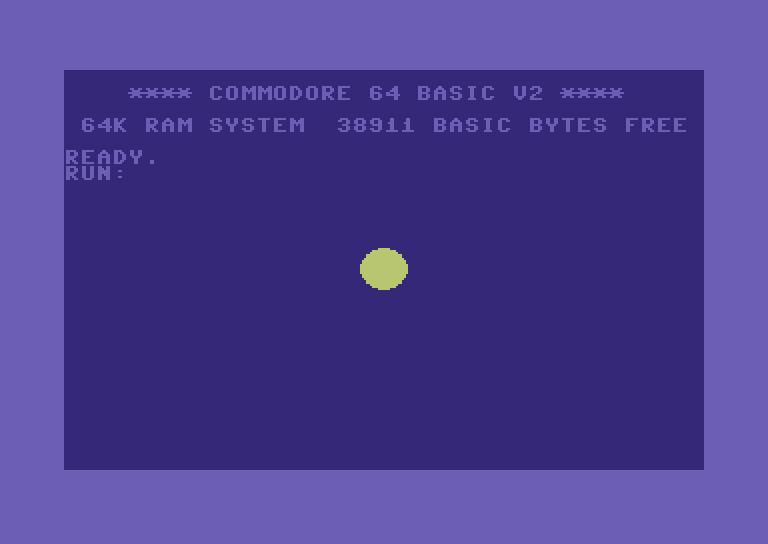
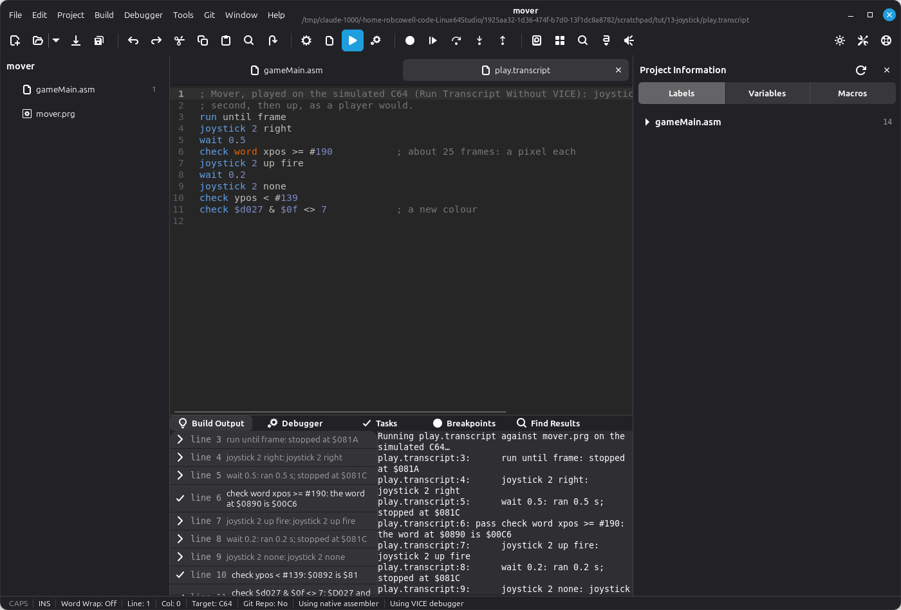

# Moving with the joystick

<!-- example: 13-joystick -->

Most C64 games are played with a joystick in port 2. You'll move a ball around the screen with it,
and change its colour with fire, then test the controls with a transcript, with no one at the
joystick. It takes about fifteen minutes.

## The program

Make an assembler project called `mover`, and replace everything below the BASIC loader in
`gameMain.asm` with this (the ball's data is at the end: draw your own in the sprite editor, as in
tutorial 3, if you like):

```
SP0X    = $D000         ; sprite 0's X (low 8 bits)
SP0Y    = $D001         ; and Y
MSIGX   = $D010         ; the 9th bit of each sprite's X
SPENA   = $D015         ; which sprites are on
SP0COL  = $D027         ; sprite 0's colour
RASTER  = $D012         ; the raster line
CIAPRA  = $DC00         ; joystick 2: bits 0-4 up, down, left, right, fire (0 = pressed)
SPRPTR0 = $07F8         ; sprite 0's data pointer (64-byte blocks)

start   lda #$2000/64   ; the ball's data, at $2000
        sta SPRPTR0
        lda #1          ; sprite 0 on
        sta SPENA

frame   lda #250        ; once a frame, at line 250
@wait   cmp RASTER
        bne @wait
        lda CIAPRA      ; read the joystick
        jsr move
        jsr place
        jmp frame

; Move by the joystick bits in A: a pixel a frame each way, a new colour on fire.
move    sta joy
        lda joy
        and #%00000001  ; up?
        bne @down
        dec ypos
@down   lda joy
        and #%00000010  ; down?
        bne @left
        inc ypos
@left   lda joy
        and #%00000100  ; left?
        bne @right
        lda xpos        ; xpos is 16 bits: take 1 from both bytes
        sec
        sbc #1
        sta xpos
        lda xpos+1
        sbc #0
        sta xpos+1
@right  lda joy
        and #%00001000  ; right?
        bne @fire
        inc xpos
        bne @fire
        inc xpos+1
@fire   lda joy
        and #%00010000  ; fire?
        bne @done
        inc colour
@done   rts

; Put the sprite where xpos and ypos say, in its colour.
place   lda xpos
        sta SP0X
        lda xpos+1      ; X's 9th bit, for sprite 0: bit 0
        sta MSIGX
        lda ypos
        sta SP0Y
        lda colour
        sta SP0COL
        rts

joy     byte 0          ; the joystick bits being looked at
xpos    word 172        ; where the ball is: the middle of the screen
ypos    byte 139
colour  byte 7          ; yellow

*=$2000                 ; the ball
        byte $00,$7E,$00, $03,$FF,$C0, $07,$FF,$E0, $1F,$FF,$F8, $1F,$FF,$F8, $3F,$FF,$FC, $7F,$FF,$FE
        byte $7F,$FF,$FE, $FF,$FF,$FF, $FF,$FF,$FF, $FF,$FF,$FF, $FF,$FF,$FF, $FF,$FF,$FF, $7F,$FF,$FE
        byte $7F,$FF,$FE, $3F,$FF,$FC, $1F,$FF,$F8, $1F,$FF,$F8, $07,$FF,$E0, $03,$FF,$C0, $00,$7E,$00
```

Press **Ctrl+F5**, and a yellow ball sits in the middle of the screen. Linux64Studio's **Preferences →
Emulator → Joystick in port 2** chooses what moves VICE's joystick: the keypad (8 4 6 2 to move, 0 to
fire), or a real joystick or gamepad. Choose one, run it again, and the ball moves.



How it works:

* **Reading the joystick.** `$DC00`, CIA 1's port A, has joystick 2 in its bottom five bits: up,
  down, left, right and fire. A bit is 0 while it's pressed, so `and` with the bit and `bne` skips
  the move when it's not.
* **One routine, given the bits.** The loop reads `$DC00` and passes it to `move` in A. Keeping the
  reading out of `move` means a test can call `move` with any bits it likes.
* **A 16-bit X.** The screen is wider than 256 pixels, so a sprite's X has a ninth bit, in `$D010`
  (bit 0 for sprite 0). `xpos` is a word: taking 1 from it uses `sbc` on both bytes, carrying from
  the low byte to the high one, and adding 1 is an `inc` of the low byte, then the high byte if the
  low one went round to 0.
* **A pixel a frame.** Waiting for line 250 each time round makes the loop run 50 times a second.

## Play it without VICE

Press **Ctrl+Shift+F5** (**Debug Without VICE**), click the **Screen** in the Debugger tab, and use
the arrow keys: they're joystick 2, and Right Ctrl is fire.

## Test it

The example's `tests.transcript` tests `move` on its own: it sets A to what the joystick would read
and calls it.

```
run until frame
a $f7                             ; right
call move
check word xpos = #173
a $fb                             ; left, twice (A again: move changes it)
call move
a $fb
call move
check word xpos = #171
a $fe                             ; up
call move
check ypos = #138
a $f5                             ; down and right together
call move
check ypos = #139
check word xpos = #172
a $ef                             ; fire
call move
check colour = #8
a $ff                             ; nothing
call move
check word xpos = #172
```

That runs in VICE and on the simulated C64 alike. On the simulator, a transcript can also push the
joystick itself, as a player would. Open `play.transcript` and choose **Debugger → Run Transcript
Without VICE**:

```
run until frame
joystick 2 right
wait 0.5
check word xpos >= #190           ; about 25 frames: a pixel each
joystick 2 up fire
wait 0.2
joystick 2 none
check ypos < #139
check $d027 & $0f <> 7            ; a new colour
```



`joystick 2 right` holds joystick 2 to the right until the next `joystick` line (`none` lets go), and
`wait` lets the program run for that long, in the C64's time. `hold` and `release` do the same for
keys (`hold space`).

## Try next

* Stop the ball at the screen's edges: compare `xpos` and `ypos` with the limits before moving.
* Move two pixels a frame while fire is held.
* Read joystick 1 too: it's in `$DC01`, the same bits.

Next: [a sound effect](14-sound.md).
