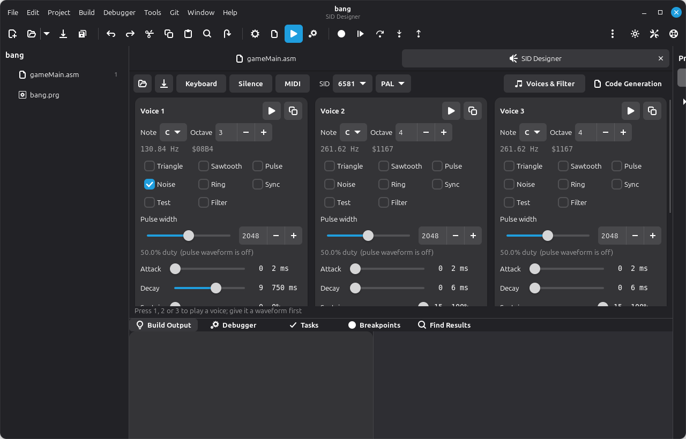
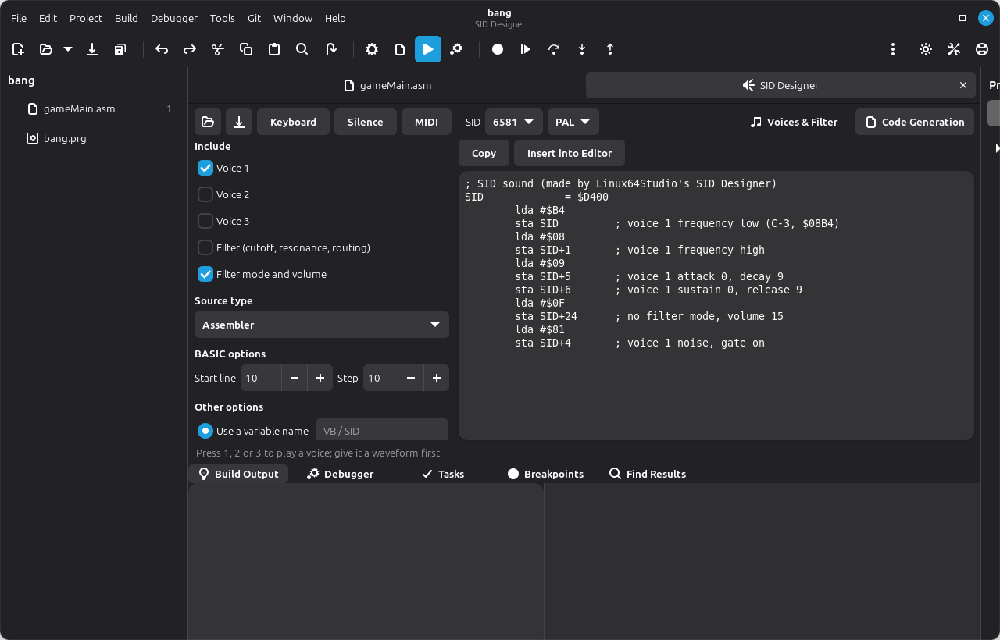

# A sound effect

<!-- example: 14-sound -->

The SID chip makes the C64's sound: three voices, each with a waveform, a pitch and an envelope that
shapes how the sound starts and fades. You'll design a bang in the SID Designer, hearing it as you go,
then put its code into a program that plays it each time a key is pressed. It takes about fifteen
minutes.

## The program around it

Make an assembler project called `bang`, and replace everything below the BASIC loader in
`gameMain.asm` with this:

```
EXTCOL  = $D020         ; the border's colour
CHROUT  = $FFD2         ; print the character in A
GETIN   = $FFE4         ; a key from the keyboard buffer in A (0: none)

start   lda #0          ; a black border
        sta EXTCOL
        ldx #0          ; and the message
@print  lda message,x
        beq loop
        jsr CHROUT
        inx
        jmp @print

loop    jsr GETIN       ; wait for a key
        beq loop
        jsr bang
        inc EXTCOL      ; (and flash the border)
        jmp loop

bang    lda #0          ; the gate off first, so the sound starts again
        sta $D404

        rts

message byte 147        ; {clear}
        text "press a key for a bang"
        byte 0
```

The sound's code goes on the empty line in `bang`.

## Design the sound

1. **Tools → Music → SID Designer.** It opens on **Voices & Filter**: the SID's three voices, and
   the filter and volume below them.
2. In **Voice 1**, tick **Noise**: the hiss that bangs and explosions are made of. Set **Octave** to
   3, for a low rumble rather than a high hiss.
3. Set the envelope: **Attack** 0 (it starts at full volume at once), **Decay** 9 (it fades over 750
   ms), **Sustain** 0 (to nothing) and **Release** 9.
4. Press **1** (or the voice's ▶ button) to hear it. The designer plays it through VICE's `vsid`,
   the real SID's sound. Try other decays, and the other waveforms, until you like it.



## Put it in the program

1. Click on the empty line in `bang`, in `gameMain.asm`, so the code goes there.
2. In the SID Designer, click **Code Generation**. Set **Source type** to **Assembler**, and untick
   **Filter (cutoff, resonance, routing)**: this sound doesn't use the filter. Leave **Filter mode and
   volume** ticked, for the volume.
3. Press **Insert into Editor**.



`bang` is now:

```
bang    lda #0          ; the gate off first, so the sound starts again
        sta $D404
; SID sound (made by Linux64Studio's SID Designer)
SID             = $D400
        lda #$B4
        sta SID         ; voice 1 frequency low (C-3, $08B4)
        lda #$08
        sta SID+1       ; voice 1 frequency high
        lda #$09
        sta SID+5       ; voice 1 attack 0, decay 9
        sta SID+6       ; voice 1 sustain 0, release 9
        lda #$0F
        sta SID+24      ; no filter mode, volume 15
        lda #$81
        sta SID+4       ; voice 1 noise, gate on
        rts
```

Press **Ctrl+F5**, then any key: a bang, and the border flashes.

How it works:

* **The registers.** The SID's are at `$D400` to `$D418`: 7 for each voice, then the filter and the
  volume. Voice 1's are `$D400`-`$D406`: its frequency (2 bytes), pulse width (2), control, and the
  envelope (2).
* **The gate.** Bit 0 of the control register (`$D404`) is the gate. Setting it starts the envelope:
  attack, then decay down to the sustain level. Clearing it starts the release. `$81` is noise
  (`$80`) with the gate on.
* **Playing it again.** The envelope only starts again when the gate goes from off to on, so `bang`
  clears it first. Without that, only the first key would bang.
* **The volume.** `$D418`'s bottom four bits are the volume for all three voices: 0 is silence.
* **The keys.** `GETIN` takes a key from the keyboard buffer the KERNAL fills (A is 0 if there's
  none), so the loop waits until one's pressed.

## Test it

```
run until loop
check $0400 = "press a key for a bang"
call bang                         ; the sound's registers
check $d400 = $b4 $08             ; C-3
check $d405 = $09 $09             ; its envelope
check $d418 & $0f = $0f           ; the volume
check $d404 = $81                 ; noise, and the gate on: playing
type "x"                          ; a key
wait 0.2
check $d020 & $0f = 1             ; the border flashed: it was heard
```

A transcript can't hear the sound, but it can check what was written to the SID. `type` puts keys in
the keyboard buffer, as if they'd been typed.

## Try next

* Make a laser instead: **Sawtooth**, a high octave, a short decay. Generate it into a second
  routine, and play it on a different key (compare A with a key's PETSCII code after `GETIN`).
* **Save** the design (a `.l64sid` file) to come back to it.
* For tunes rather than single sounds, see [music](7-music.md): a GoatTracker song, played from a
  raster interrupt.

Next: [Kick Assembler](15-kickass.md).
