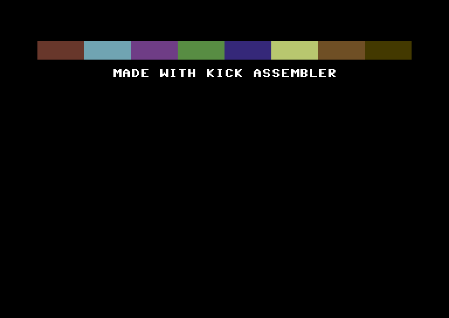
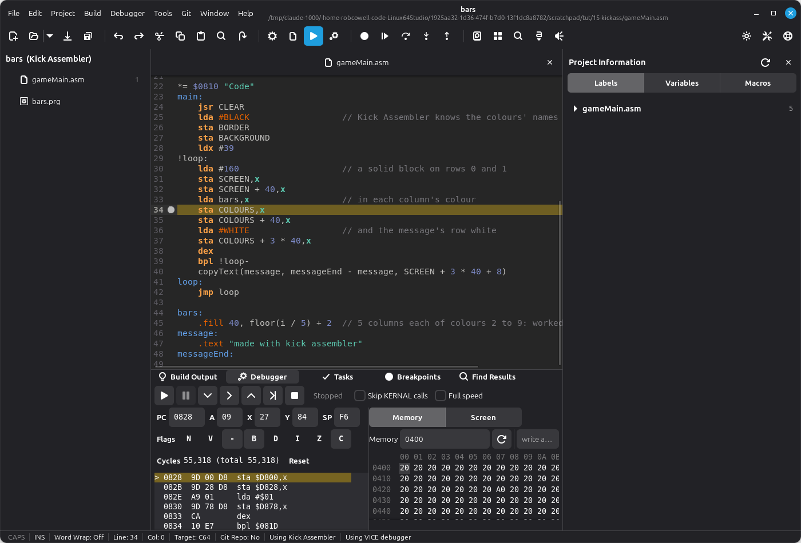

# Kick Assembler

<!-- example: 15-kickass -->

Kick Assembler is the other assembler C64 programmers use most, and the one the Retro Game Dev
books' second volume uses. It has a scripting language built in: loops, functions and data worked
out as the program is built. Linux64Studio builds Kick Assembler projects and debugs them line by
line, like its own. You'll write colour bars and a message with it. It takes about fifteen minutes.

## Kick Assembler itself

Kick Assembler is a Java program, so it needs Java (`sudo apt install default-jre`). Then run
`tools/install-kickassembler.sh` from Linux64Studio's folder, which downloads the latest Kick
Assembler to where Linux64Studio looks for it. Or, if you have a `KickAss.jar` already (the book's
`Tools/KickAssembler` folder has one), choose it in **Preferences → Kick Assembler**.

## The program

**File → New → Project…**, call it `bars`, and set **Type** to **Kick Assembler**. Its `gameMain.asm`
starts with Kick Assembler's way of writing the BASIC loader, `BasicUpstart`. Replace it all with
this:

```
// Bars: colour bars and a message, in Kick Assembler.

.const SCREEN = $0400
.const COLOURS = $d800
.const BORDER = $d020
.const BACKGROUND = $d021
.const CLEAR = $e544            // the KERNAL's screen clear

// Copy a piece of text to the screen (a macro: its code is put in where it's used)
.macro copyText(text, length, where) {
    ldx #length - 1
!loop:
    lda text,x
    sta where,x
    dex
    bpl !loop-
}

*= $0801 "Basic Loader"
    BasicUpstart(main)

*= $0810 "Code"
main:
    jsr CLEAR
    lda #BLACK                  // Kick Assembler knows the colours' names
    sta BORDER
    sta BACKGROUND
    ldx #39
!loop:
    lda #160                    // a solid block on rows 0 and 1
    sta SCREEN,x
    sta SCREEN + 40,x
    lda bars,x                  // in each column's colour
    sta COLOURS,x
    sta COLOURS + 40,x
    lda #WHITE                  // and the message's row white
    sta COLOURS + 3 * 40,x
    dex
    bpl !loop-
    copyText(message, messageEnd - message, SCREEN + 3 * 40 + 8)
loop:
    jmp loop

bars:
    .fill 40, floor(i / 5) + 2  // 5 columns each of colours 2 to 9: worked out as it's built
message:
    .text "made with kick assembler"
messageEnd:
```

Press **Ctrl+F5**: eight colour bars across the top, and the message below them.



How it differs from CBM prg Studio's assembler:

* **Labels end in a colon** (`main:`), and comments start with `//`.
* **Directives start with a dot**: `.const` for a constant, `.fill` and `.text` for data, `.macro`
  for a macro.
* **`BasicUpstart(main)`** is a macro Kick Assembler comes with: it writes the BASIC `SYS` line that
  starts `main`.
* **`!loop:` labels** can be used again and again: `!loop-` means the nearest one before, `!loop+`
  the nearest one after.
* **Scripts.** `.fill 40, floor(i / 5) + 2` makes 40 bytes, working each one out from `i`, its place:
  5 of colour 2, 5 of colour 3, and so on. Kick Assembler can work out tables (sines, say) and even
  load pictures as it builds.
* **Colours by name**: `BLACK`, `WHITE`, `RED` and the rest are built in.
* **Macros with parameters**: `copyText` puts its loop in where it's used, with the text, length and
  place given.

## Debug it

Click in the gutter beside `sta COLOURS,x` to set a breakpoint, and press **F5** (or **Ctrl+Shift+F5**
without VICE). It stops there, with the line highlighted, as in a CBM prg Studio project. **F10** steps
a line; **F8** goes round the loop again, and each time X is one less. Linux64Studio asks Kick
Assembler for a debug dump (a `.dbg` file) on every build, which says which source line made which
bytes, so the debugger can follow the source.



## Test it

Transcripts work with Kick Assembler projects too, using its labels:

```
run until loop
check $0400 = $a0 $a0 $a0         ; solid blocks along the top
check $d800 & $0f = 2             ; the first bar red
check $d827 & $0f = 9             ; the last brown (column 39: 39 / 5 = 7, + 2)
check $0480 = "made with kick assembler"   ; row 3, from column 8
```

## The book's Volume 2

The second volume's projects are VS Code workspaces (`.code-workspace` files). **File → Open
Project** opens one as it is, builds it with Kick Assembler, and debugs it like this one.

## Try next

* Make the bars a rainbow with a list: `.var colours = List().add(2, 8, 7, 5, 6, 4)`, and `.fill 40,
  colours.get(floor(i / 7))`.
* Select some lines of numbers in the editor, right-click, and choose **Create Kick List…** (or **Create
  Kick Hash Table…**) to turn them into Kick Assembler's `List` or `Hashtable`.
* Read Kick Assembler's manual, in its download, for the rest of its script language.

That's the last tutorial. The Retro Game Dev books carry on from here: open a chapter's `.cbmprj`
(Volume 1) or `.code-workspace` (Volume 2) with **File → Open Project**.
