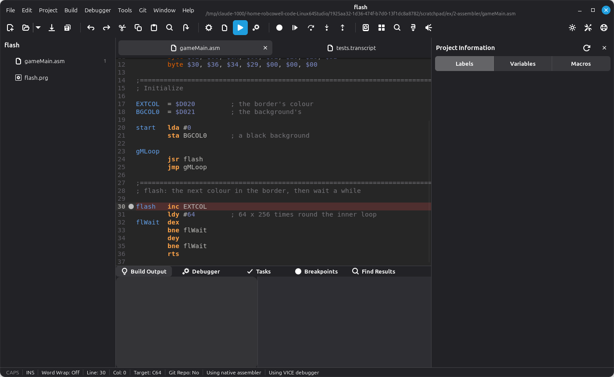
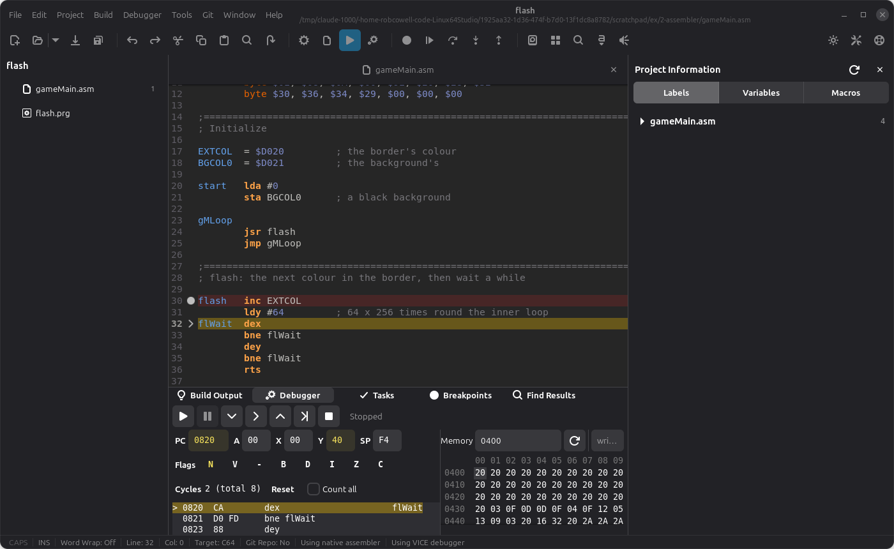

# Your first assembler program

<!-- example: 2-assembler -->

You'll write a machine-code program that flashes the border through the C64's 16 colours, run it,
then stop it in the debugger and step through it an instruction at a time. It takes about ten
minutes.

## Make a project

1. **File → New → Project…**
2. Name it `flash`, and choose **Assembler (CBM prg Studio syntax)** as its type: the syntax the
   Retro Game Dev books use.
3. Press **Create**.

The project opens with `gameMain.asm`, a starter that already works. Press **Ctrl+F5** to see it
run: the border flickers through the colours far too fast to see each one.

## How it starts

A machine-code program on the C64 is usually started from BASIC, with `SYS` and the address of its
first instruction. The top of `gameMain.asm` does that:

```
*=$0801 ; 10 SYS (2064)

        byte $0E, $08, $0A, $00, $9E, $20, $28, $32
        byte $30, $36, $34, $29, $00, $00, $00
```

`*=$0801` says where the bytes after it go: `$0801`, where BASIC programs start. The bytes are a
one-line BASIC program, `10 SYS (2064)`, already tokenized. When the program is loaded and RUN, it
starts the machine code at 2064, which is `$0810`: straight after it.

## Slow it down

Replace everything below the BASIC loader with this:

```
EXTCOL  = $D020         ; the border's colour
BGCOL0  = $D021         ; the background's

start   lda #0
        sta BGCOL0      ; a black background

gMLoop
        jsr flash
        jmp gMLoop

flash   inc EXTCOL
        ldy #64         ; 64 x 256 times round the inner loop
flWait  dex
        bne flWait
        dey
        bne flWait
        rts
```

`flash` moves the border on to the next colour (`inc`), then counts X down 256 times, 64 times
over, before it returns (`rts`). The main loop calls it over and over (`jsr`, then `jmp` back).

Words at the start of a line, such as `start`, `gMLoop` and `flash`, are **labels**: names for the
address the line's code goes at. `EXTCOL = $D020` gives a name to a number. Press **Ctrl+F5**: the
border now changes colour about 12 times a second, slow enough to see each one.



## Debug it

Press **Shift+F5** (Debug Project). VICE starts again, this time with Linux64Studio watching it,
and the **Debugger** tab opens at the bottom.

1. **Set a breakpoint.** Click the line number of `flash   inc EXTCOL` (or put the cursor on the
   line and press **F9**). A dot appears in the margin and the line turns red. The program stops there straight away, since
   it's called all the time: the line is highlighted, and the Debugger tab shows the registers,
   the code around the PC and memory.
2. **Step.** Press **F11** (Step Into) to run one instruction. The highlight moves to the next
   line, and registers that changed are highlighted. Step a few times through the loop and watch
   X count down.
3. **Count cycles.** Under the flags, **Cycles** shows how long each step took: 2 for `dex`, 3 for a
   `bne` that branches, 2 for one that doesn't. That's exact, as the real C64 would take.
4. **Carry on.** Press **F8** (Continue). The program runs until it gets back to the breakpoint, one
   colour later.
5. **Skip.** At the breakpoint, press **Shift+F8** (Skip Instruction): the PC moves past `inc` without
   running it, so this time the colour doesn't change.



Click the line number again to remove the breakpoint, and press **F8** to let the program run on.
**Stop debugging** (the square button) closes VICE.

## Try next

* Change `ldy #64` to `ldy #8` or `ldy #255` and see the speed change. At `#8` each colour lasts
  less than a frame, so the border shows bands of two colours at once.
* Put `lda #6`, `sta EXTCOL` in `start` and see which colour the border starts at.

Next: [sprites](3-sprites.md), or [testing `flash` with a transcript](4-transcripts.md).
