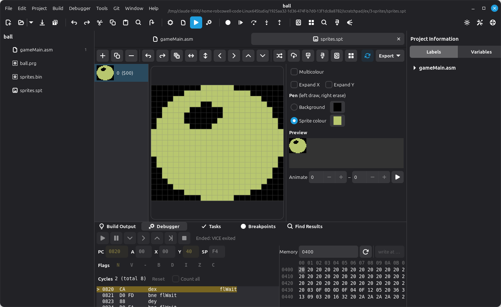
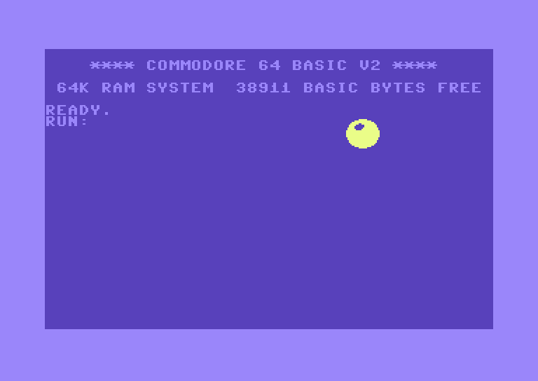

# Sprites

<!-- example: 3-sprites -->

You'll draw a ball in the sprite editor and make it float across the screen, a pixel every frame.
It takes about fifteen minutes. It builds on [your first assembler program](2-assembler.md).

## Make a project

**File → New → Project…**, name it `ball`, choose **Assembler (CBM prg Studio syntax)**, and press
**Create**.

## Draw the sprite

A sprite is a 24 × 21 pixel picture the VIC-II draws over the screen, wherever it's told to. It
takes 63 bytes: 3 bytes a row, a bit a pixel.

1. **File → New → Sprite Set…**, and call it `sprites.spt`. The sprite editor opens with one empty
   sprite.
2. Draw a ball: the **left** mouse button draws, the **right** button rubs out. Any shape will do.
3. Pick a colour for it (yellow is 7).
4. Click the button with two arrows in the editor's toolbar (**Files updated automatically when you
   save**) and tick **Sprite data (.bin)**. From now on, every time you save the sprite set,
   `sprites.bin` is written beside it: the 64 bytes the program will include.
5. Save it (**Ctrl+S**).



## Show it

Replace everything below the BASIC loader in `gameMain.asm` with this:

```
SP0X    = $D000         ; sprite 0's x position (the low 8 bits)
SP0Y    = $D001         ; and y
RASTER  = $D012         ; the line the VIC-II is drawing
SPENA   = $D015         ; which sprites are on, a bit each
SP0COL  = $D027         ; sprite 0's colour
SPRPTR0 = $07F8         ; sprite 0's data: block number (address / 64)

start   lda #SPRITES/64 ; the ball's data, at $2000: block 128
        sta SPRPTR0
        lda #7          ; yellow
        sta SP0COL
        lda #100
        sta SP0Y
        lda #24         ; the screen's left edge
        sta SP0X
        lda #%00000001  ; sprite 0 on
        sta SPENA

gMLoop  lda #250        ; wait for line 250, below the screen
gMWait  cmp RASTER
        bne gMWait
        inc SP0X
        jmp gMLoop

*=$2000
SPRITES
        incbin "sprites.bin"
```

How it works:

* **The data.** `incbin` puts `sprites.bin` into the program at `$2000`. The VIC-II finds a
  sprite's data by a block number, the address divided by 64, in the last 8 bytes of screen memory
  (`$07F8` for sprite 0). `$2000 / 64` is 128.
* **Turning it on.** Each bit of `$D015` switches a sprite on. Its colour, x and y go in the VIC-II's
  registers too.
* **Moving it.** The loop waits for the raster, the line the VIC-II is drawing, to reach line 250,
  below the visible screen, then moves the ball a pixel right. That happens once a frame, 50 times a
  second on a PAL C64, so the movement is smooth, and never in the middle of drawing the ball.

Press **Ctrl+F5**. The ball floats across from the left.



## Change the sprite

Go back to the sprite editor, change the drawing, and save. `sprites.bin` is written again, so
pressing **Ctrl+F5** shows the new ball straight away.

## Try next

* Three quarters of the way across, the ball jumps back to the left: `inc` takes x from 255 to 0.
  A sprite's x is 9 bits, and the 9th, for 256 and over, is bit 0 of `$D010`. Set it, and the ball
  can reach the right edge.
* Move it down as well, with `inc SP0Y`.
* **Expand X** and **Expand Y** in the sprite editor show how it looks doubled. The program has to
  set `$D01D` and `$D017` to match.

Next: [testing with a transcript](4-transcripts.md).
