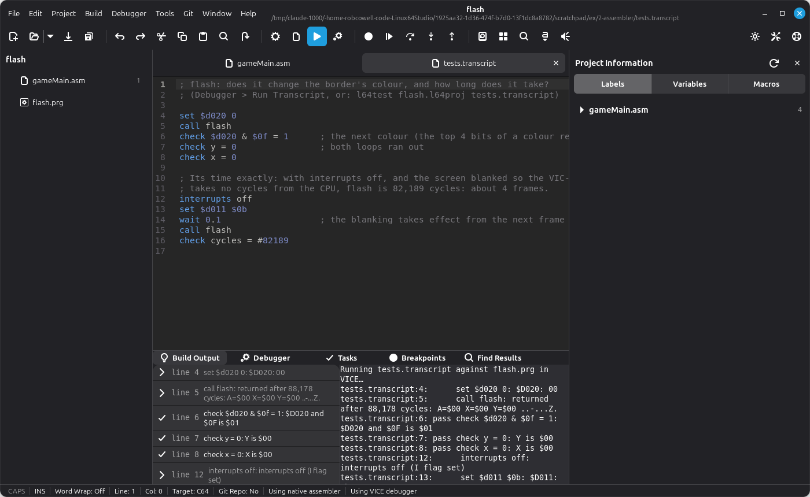

# Testing with a transcript

<!-- example: 2-assembler -->

You'll write a transcript for the `flash` routine from [your first assembler program](2-assembler.md):
a script that calls it in VICE and checks what it did, including exactly how long it took. Run it
whenever you change the code, and it tells you at once if something broke. It takes about ten
minutes.

## Write the transcript

Open your `flash` project (or the example). Then **File → New → Transcript (tests)…** and call it
`tests.transcript`. It starts with a list of the commands as comments. Below them, write:

```
set $d020 0
call flash
check $d020 & $0f = 1
check y = 0
check x = 0
```

Line by line:

* `set $d020 0` puts 0 (black) in the border's colour register.
* `call flash` runs `flash` as a `jsr` would, and waits for it to return.
* `check $d020 & $0f = 1` checks the border went on to the next colour. The VIC-II's colour
  registers only have 4 bits; the other 4 read as 1, so `& $0f` keeps the colour's own.
* `check y = 0` and `check x = 0` check both loops ran out.

Numbers are hex, as in the debugger, and labels can be used anywhere an address can.

## Run it

**Debugger → Run Transcript** (or right-click in the transcript, **Run Transcript**). The project is
built, VICE starts with the program loaded but not running, and each line runs in turn. The results
come up in **Build Output**: a tick for each check that passed, and a red mark for one that failed,
both in the list and in the transcript's margin.



To see a failure, change the first check to `= 2` and run it again: it says *$D020 and $0F is $01,
not = 2*. Put it back.

## Time it

Add these lines:

```
interrupts off
set $d011 $0b
wait 0.1
call flash
check cycles = #82189
```

* `interrupts off` stops the KERNAL's interrupt from running in the middle of `flash` and adding its
  own time.
* `set $d011 $0b` blanks the screen. While the screen is on, the VIC-II takes cycles from the CPU on
  every eighth line to fetch the characters (*badlines*), which would make the time depend on where
  in the frame `flash` ran. `wait 0.1` lets a frame go by, as the blanking takes effect from the next
  one.
* `check cycles = #82189` checks the call took exactly 82,189 cycles (`#` is decimal). That's
  `inc` (6) and `ldy` (2), then 64 times round the outer loop, each time 256 times round the inner
  one (`dex`, 2, and `bne`, 3 when it branches), and `rts` (6). About 4 frames.

Change `ldy #64` to `ldy #32`, run the transcript again, and the cycle check fails with the new
time. Put it back.

## From the command line

The same transcript runs without the IDE, which suits a script or a build that checks everything:

```
l64test flash.l64proj tests.transcript --vice-args="-sounddev dummy"
```

It prints a line for each command, and its exit status is the number of failed checks: 0 when all
is well. (`l64test` is in `.venv/bin` where Linux64Studio is installed.)

## Try next

* Check what `start` does: `call start` never returns, as it loops for ever, so use
  `goto start` and `until gMLoop`, then check `$d021`.
* [Transcripts](../debugger.md#transcripts) has every command.

Next: [C with cc65](5-c.md).
