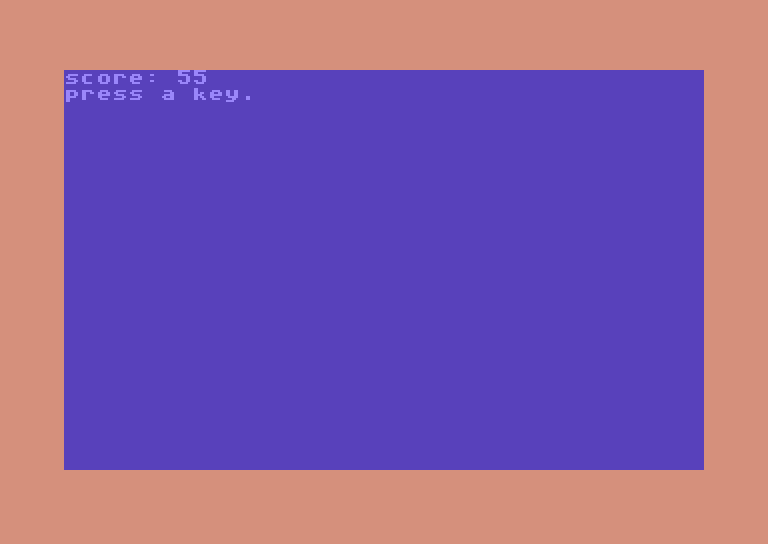
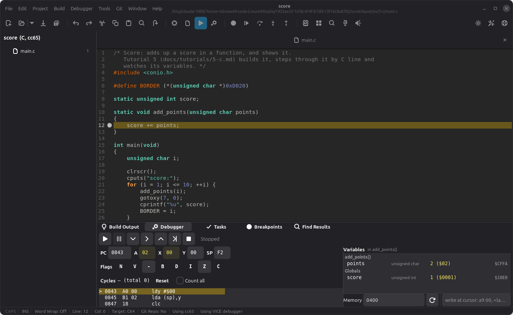

# C with cc65

<!-- example: 5-c -->

You'll write a small C program, run it, and step through it a line of C at a time, watching its
variables change. It takes about ten minutes, and needs cc65: `sudo apt install cc65`.

## Make a project

**File → New → Project…**, name it `score`, choose **C (cc65)**, and press **Create**. The project
opens with `main.c`, a starter that prints a message and flashes the border. **Ctrl+F5** runs it.

## Write the program

Replace `main.c` with this:

```c
#include <conio.h>

#define BORDER (*(unsigned char *)0xD020)

static unsigned int score;

static void add_points(unsigned char points)
{
    score += points;
}

int main(void)
{
    unsigned char i;

    clrscr();
    cputs("score:");
    for (i = 1; i <= 10; ++i) {
        add_points(i);
        gotoxy(7, 0);
        cprintf("%u", score);
        BORDER = i;
    }
    cputs("\r\npress a key.");
    while (!kbhit()) {
    }
    return 0;
}
```

`conio.h` is cc65's console library: `clrscr`, `cputs`, `gotoxy` and `cprintf` write to the screen,
and `kbhit` says whether a key's been pressed. `BORDER` is the VIC-II's border colour register,
`$D020`, as a C variable. Use `unsigned char` for numbers up to 255: the 6510 works a byte at a
time, so it's much faster than `int`.

Press **Ctrl+F5**: *score: 55* comes up, the sum of 1 to 10, with the border's colour changed.



## Step through it

1. Click the line number of `score += points;` to put a breakpoint there, and press **Shift+F5**
   (Debug Project). The program stops on that line the first time `add_points` is called.
2. The **Variables** list, above the memory in the Debugger tab, shows the function's own variables,
   `points` (1), and the program's globals, `score` (0).
3. Press **F10** (Step Over). It goes to the next line of C, not the next instruction: `score` is now
   1, highlighted as it changed.
4. Press **F8** (Continue) a few times. Each time it stops in `add_points` again, with `points` one
   more and `score` the total so far.
5. Hover the mouse over `score` in the editor for its address in memory.



Remove the breakpoint and press **F8** to let it finish.

Behind each line of C are many instructions, which **Step Into One Instruction** (Ctrl+F11) steps
through with the disassembly beside it, if you want to see what cc65 made.

## Try next

* Add a second function, `bonus`, that doubles the score, and step into it with **F11**.
* The transcript in the example project checks the score from VICE: open it, and **Debugger →
  Run Transcript**.
* [C with cc65](../c.md) covers everything else: other C files, fixed addresses for data, music.

Next: [characters and a screen](6-screen.md).
