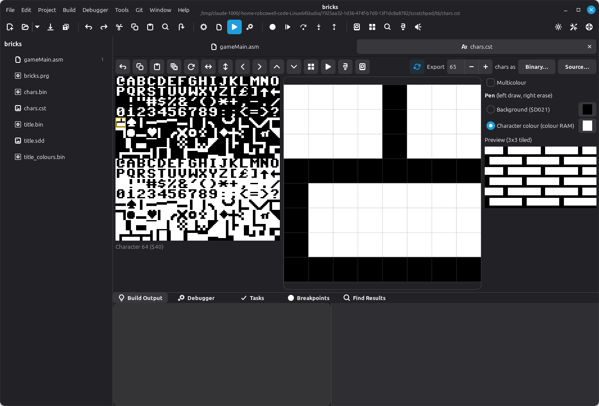
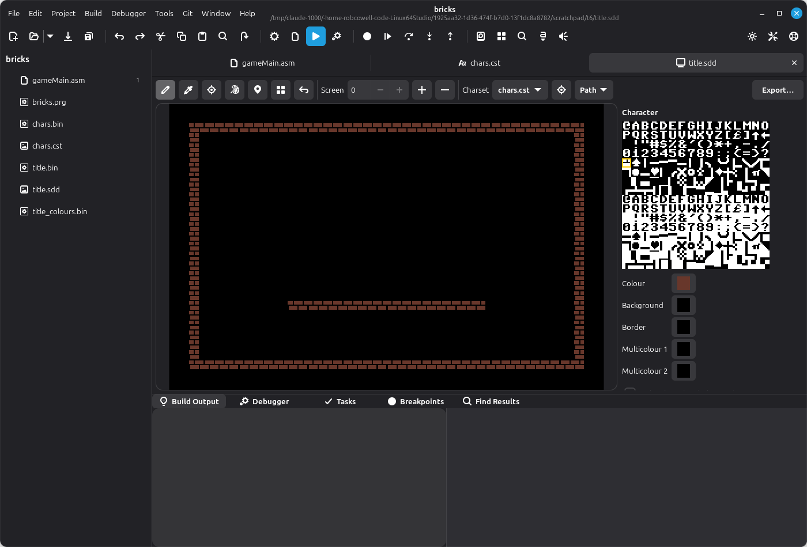
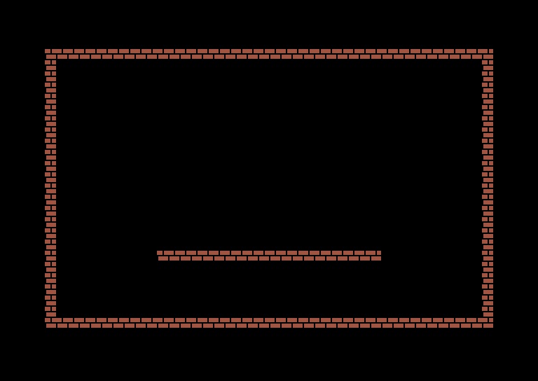

# Characters and a screen

<!-- example: 6-screen -->

Most C64 games draw their backgrounds from characters: the 8 × 8 pictures the screen is made of.
You'll draw a brick character in the character set editor, build a screen of bricks with it in the
screen designer, and show it from a program. It takes about fifteen minutes.

## Draw a character

Make an assembler project called `bricks` (**File → New → Project…**).

1. **File → New → Character Set…**, and call it `chars.cst`. The character set editor opens with
   the C64's own 256 characters, copied from its ROM: letters, digits and graphics.
2. Click character 64 in the grid, the horizontal line straight after the `?`. The status under the
   grid says *Character 64 ($40)*.
3. Clear it with the toolbar's **Clear character** button, and draw a brick in the big grid: the
   left button draws, the right rubs out. Two rows of bricks with a line of gaps between them, say.
   The **Preview** tiles it, so you can see the bricks join up.
4. Click the button with two arrows in the toolbar (**Files updated automatically when you save**) and
   tick **Character data (.bin)**. From now on, saving writes `chars.bin` beside it: 8 bytes a
   character, for the program to include.
5. Save it (**Ctrl+S**).



## Design a screen

1. **File → New → Screen Design…**, and call it `title.sdd`. The screen designer opens with an empty
   40 × 25 screen.
2. Set **Charset** in its toolbar to `chars.cst`: the screen is drawn in your characters now.
3. On the right, set **Colour** to red (2), and **Background** and **Border** to black (0).
4. Click your brick in the character grid on the right, and draw with the left button: a wall round
   the edge of the screen, and a platform across the middle. **Ctrl+Z** undoes.
5. Save it, then **Export…**: tick **Colour data**, press **Export…**, and save it as `title.bin`.
   That writes `title.bin`, the 1,000 characters, and `title_colours.bin`, their 1,000 colours.



The screen's export isn't written automatically: export again after changing the design. If you
change a character, save the character set, and then close and open the screen design to see it.

## Show it

Replace everything below the BASIC loader in `gameMain.asm` with this:

```
SCREEN  = $0400         ; the screen's characters
COLOURS = $D800         ; and their colours
EXTCOL  = $D020         ; the border's colour
BGCOL0  = $D021         ; the background's
VMCSB   = $D018         ; where the VIC-II finds the screen and the characters

start   lda #0          ; a black border and background
        sta EXTCOL
        sta BGCOL0
        ldx #250        ; 4 x 250 = 1,000: the whole screen
@copy   lda titleChars-1,x
        sta SCREEN-1,x
        lda titleChars+249,x
        sta SCREEN+249,x
        lda titleChars+499,x
        sta SCREEN+499,x
        lda titleChars+749,x
        sta SCREEN+749,x
        lda titleColours-1,x
        sta COLOURS-1,x
        lda titleColours+249,x
        sta COLOURS+249,x
        lda titleColours+499,x
        sta COLOURS+499,x
        lda titleColours+749,x
        sta COLOURS+749,x
        dex
        bne @copy
        lda #%00011100  ; the screen at $0400 (0001), the characters at $3000 (110)
        sta VMCSB

gMLoop  jmp gMLoop

*=$3000
        incbin "chars.bin"
titleChars incbin "title.bin"
titleColours incbin "title_colours.bin"
```

How it works:

* **The data.** `incbin` puts the three files into the program: the characters at `$3000`, then the
  screen and its colours straight after them.
* **Copying the screen.** The screen is 1,000 bytes at `$0400`, and each place's colour is at the
  same place in the colour memory at `$D800`. The loop copies a quarter of each per go, 250 times,
  as X counts down from 250 to 1.
* **Using the characters.** `$D018` tells the VIC-II where the screen and the characters are, in
  its 16K: the top four bits are the screen, in 1K steps (1 is `$0400`), and the next three the
  characters, in 2K steps (6 is `$3000`). **Tools → Memory Manager** works these values out for you.
* The labels are `titleChars` and `titleColours` because labels are the same whatever their case:
  `screen` would clash with `SCREEN`.

Press **Ctrl+F5**: a wall of red bricks, with a platform across the middle.



## Try next

* Draw a second character (65, say) for something to collect, and put a few on the screen.
* Tick **Multicolour** in the character set editor for characters with four colours, two pixels
  wide, as most games use.

Next: [music](7-music.md).
