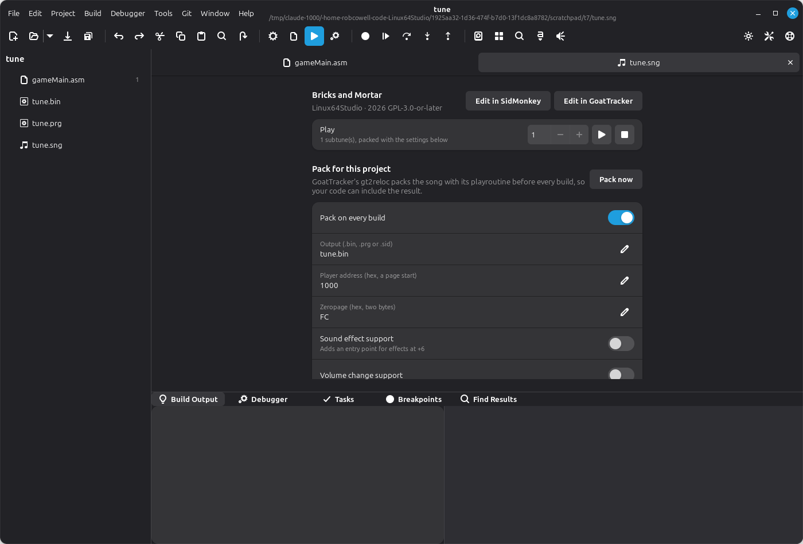

# Music

<!-- example: 7-music -->

You'll play a GoatTracker song from a program: the build packs the song with GoatTracker's player,
and a raster interrupt plays a frame of it 50 times a second, while the program carries on with
whatever else it does. It takes about fifteen minutes, and needs GoatTracker GTK Edition's tools
(see [music](../music.md)).

## The song

Make an assembler project called `tune` (**File → New → Project…**). It needs a song: copy
`tune.sng` from the example project into the project's folder (in **Help → Tutorials**, **Open the
Example Project** opens a copy of it), or write your own in GoatTracker (**Tools → Music → Open
GoatTracker**). `tune.sng` is a short tune written for these tutorials: a melody on voice 1 and a
bass line on voice 2, round and round.

Double-click `tune.sng` in the file tree. The song's page shows its name and author, with **Edit in
GoatTracker** and **Edit in SidMonkey** to change it, and **Play** to hear it.

Switch on **Pack on every build**. Now each build first runs GoatTracker's `gt2reloc`, which packs
the song with its player into `tune.bin`, for the program to include. The settings below it say
where the player goes: `$1000`, using two bytes of zero page at `$FC`. **Code to play it**, further
down, shows how to call it.



## Play it

Replace everything below the BASIC loader in `gameMain.asm` with this:

```
MUSIC   = $1000         ; the player: init at MUSIC, play at MUSIC+3
IRQVEC  = $0314         ; the KERNAL's interrupt vector
CONTROL = $D011         ; its top bit is the raster line's 9th
RASTER  = $D012         ; the line to interrupt at
IRQFLAG = $D019         ; which VIC-II interrupt happened
IRQMASK = $D01A         ; which ones are on
CIAICR  = $DC0D         ; the CIA's interrupts
KERNIRQ = $EA31         ; the KERNAL's own handler: keyboard, clock

start   lda #0          ; the song's first tune
        jsr MUSIC       ; init
        sei             ; no interrupts while they're changed
        lda #%01111111  ; the CIA's timer interrupts off
        sta CIAICR
        lda CIAICR      ; (and any that's waiting)
        lda #<irq       ; ours instead
        sta IRQVEC
        lda #>irq
        sta IRQVEC+1
        lda #0          ; at raster line 0
        sta RASTER
        lda CONTROL
        and #%01111111
        sta CONTROL
        lda #1          ; raster interrupts on
        sta IRQMASK
        cli

gMLoop  jmp gMLoop      ; the game would go here

irq     lda #1          ; this interrupt's dealt with
        sta IRQFLAG
        inc frames
        jsr MUSIC+3     ; play a frame of the tune
        jmp KERNIRQ

frames  byte 0

*=$1000
        incbin "tune.bin"
```

How it works:

* **Starting the song.** `jsr MUSIC` with 0 in A starts the song's first tune. From then on, each
  `jsr MUSIC+3` plays one frame of it: the player moves the notes on and writes the SID's registers.
  It has to be called once a frame, at the same moment each frame, for the tempo to be even.
* **Once a frame.** The VIC-II can interrupt the 6510 when it starts drawing a line. The program
  asks for line 0 (`RASTER`, and `CONTROL`'s top bit, as there are more than 256 lines), turns that
  interrupt on (`IRQMASK`), and turns off the CIA's timer interrupt, which the KERNAL uses 60 times
  a second. When an interrupt comes, the 6510 goes to the address in `IRQVEC` (by way of the KERNAL):
  `irq`.
* **The interrupt.** `irq` tells the VIC-II it's been seen (`IRQFLAG`), counts the frame, plays the
  song, and finishes with the KERNAL's own handler, which reads the keyboard, ticks the clock, and
  returns to wherever the program was.
* `sei` and `cli` keep interrupts off while they're being set up, so one can't come halfway.

Press **Ctrl+F5**. The song plays, round and round, while the main loop does nothing.

## Change the song

Click **Edit in GoatTracker**, change a note or the tempo, and save it there. Press **Ctrl+F5**
again: the build packs the new version, so the program plays it straight away.

## Try next

* Write a song of your own in GoatTracker, save it as `tune.sng`, and build again.
* Change `sta IRQMASK`'s 1 to 0 and see the music stop: no interrupts, no frames.
* [Debugging without VICE](10-simulator.md) can't play it: the simulator has no interrupts.

Next: [a game on a disk](8-disk.md).
