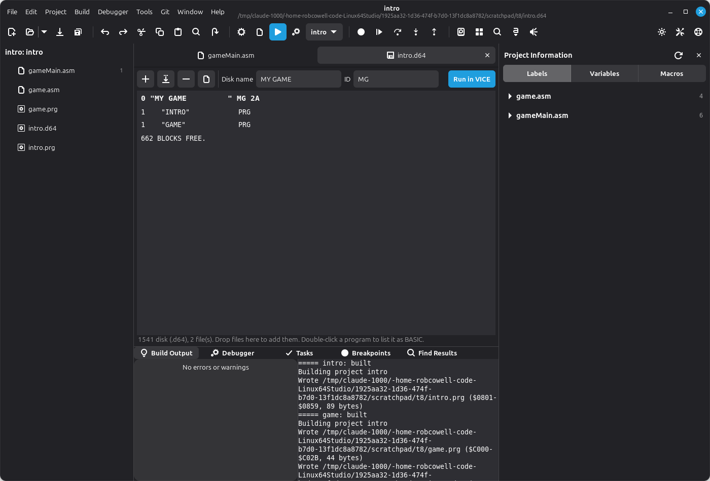

# A game on a disk

<!-- example: 8-disk -->

Games were often bigger than a single program: an intro that loads the game, or levels loaded as
they're needed. You'll make a project with two programs, an intro and a game, have the build put
both on a disk image, and have the intro load the game from the disk with the KERNAL. It takes about
fifteen minutes.

## The intro

Make an assembler project called `intro` (**File → New → Project…**). Replace everything below the
BASIC loader in `gameMain.asm` with this:

```
CHROUT  = $FFD2         ; print the character in A
SETLFS  = $FFBA         ; file number, device, secondary address
SETNAM  = $FFBD         ; the file's name: A its length, X/Y its address
LOAD    = $FFD5         ; load it (A = 0)
EXTCOL  = $D020         ; the border's colour
GAME    = $C000         ; where the game starts

start   ldx #0
@print  lda message,x
        beq loadGame
        jsr CHROUT
        inx
        jmp @print

loadGame lda #1         ; file 1
        ldx #8          ; on device 8, the disk drive
        ldy #1          ; secondary address 1: load it where the file says
        jsr SETLFS
        lda #4          ; the name, 4 letters long
        ldx #<name
        ldy #>name
        jsr SETNAM
        lda #0          ; 0 to load (1 would verify)
        jsr LOAD
        bcs failed      ; the carry's set if it didn't load
        jmp GAME

failed  inc EXTCOL      ; flash the border: something's wrong
        jmp failed

name    text "game"
message byte 147        ; {clear}
        text "loading the game..."
        byte 13, 0
```

It prints a message, then loads the file called `game` from the disk, as `LOAD"GAME",8,1` would
in BASIC: `SETLFS` says which drive (8) and that the file goes where its own first two bytes say
(secondary address 1), `SETNAM` gives the name, and `LOAD` loads it. Then it jumps to the game.
Labels are the same whatever their case, so the label is `loadGame`, not `load`, which would
clash with `LOAD`.

## The game

A project can build more than one program. **Project → New Program…**, call it `game`, and untick
*Start with the current program's files*. The toolbar's drop-down (beside the build buttons) now
says `game`: it's the current program, the one that builds and runs.

Right-click the project folder in the file tree, **New → Source File…**, and call it `game.asm`.
Right-click it and choose **Add to Build**, so it's the `game` program's. Write this in it:

```
*=$C000

CHROUT  = $FFD2         ; print the character in A
EXTCOL  = $D020         ; the border's colour

gameStart
        lda #5          ; a green border: we're in the game
        sta EXTCOL
        ldx #0
@print  lda message,x
        beq gMLoop
        jsr CHROUT
        inx
        jmp @print

gMLoop  jmp gMLoop      ; the game would go here

message text "the game is running."
        byte 13, 0
```

It goes at `$C000`, a 4K block BASIC doesn't use, and it has no BASIC loader: nothing types `RUN`
for it, since the intro starts it with `jmp`.

## Put them on a disk

**Project → Properties… → Disk Image**: switch on *Write a disk image*, name the disk `my game` with
the ID `mg`, and switch on *Run from the disk image*. Then choose `intro` in the toolbar's
drop-down, so it's the one that runs.

**Build → Build All Programs** builds both, and writes `intro.d64` with both on it, by name. Build
Output says so: *Wrote …/intro.d64 (2 file(s), 662 blocks free)*.

Press **Ctrl+F5**. VICE starts from the disk image, as if it were in a real 1541. It loads
`intro` and runs it, the intro loads `game`, and the border turns green with *the game is running.*
under the intro's message. VICE's drive takes a few seconds, as a real one would.

## Look at the disk

Double-click `intro.d64` in the file tree. It opens as `LOAD"$",8` would show it: the disk's name,
`MY GAME`, its ID, the two programs with their sizes in blocks, and the blocks free. You can add
files to it here (or drag them in), take them out, rename the disk, or double-click a BASIC
program to list it.



A disk image is written again by every build, so edit the project rather than the image: files
that should always be on it go in **Project Properties → Disk Image → More files on the disk**.

## Test it

The example's transcript checks the whole thing. When the project writes a disk image, VICE gets the
disk in drive 8 for the transcript too, so the intro can load from it:

```
timeout 30
run until $c000
check $0400 = "loading the game"
wait 0.5
check $0428 = "the game is running."
check $d020 & $0f = 5
```

`timeout 30` gives the load more time than the usual 10 seconds, and `run until $c000` waits for
the game's first instruction: once the intro has loaded it and jumped there. Run **Build All
Programs** first, so the disk has the latest game on it. `l64test` builds every program itself.

## Try next

* Change the name in the intro to `gamex` (and its length to 5), and see the border flash: the file
  isn't there, so `LOAD` comes back with the carry set.
* Add a third program, `level2`, at `$C800`, and have the game load it.

Next: [finding what's slow](9-profiler.md).
