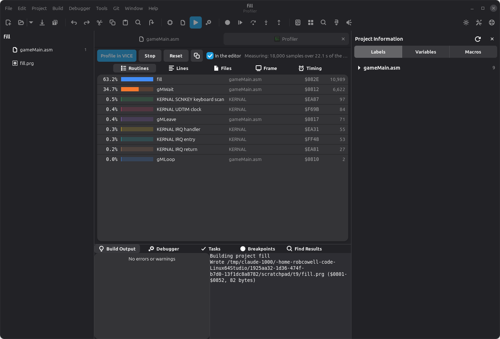
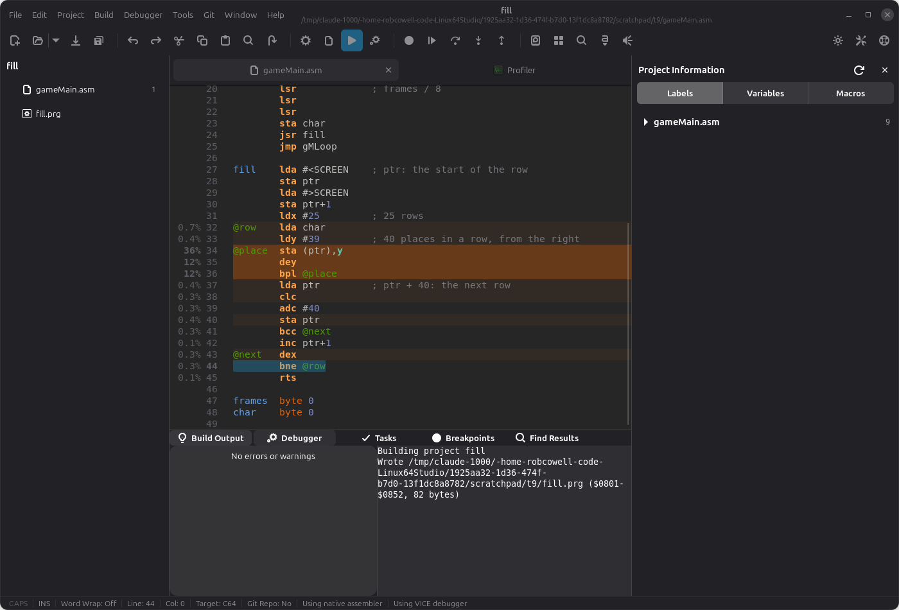

# Finding what's slow

<!-- example: 9-profiler -->

A game has one frame, 19,656 cycles on a PAL C64, to do everything before the screen is drawn again.
You'll write a routine that fills the screen, measure where the time goes with the profiler, time
the routine to the cycle, then make it twice as fast and measure again. It takes about fifteen
minutes.

## The program

Make an assembler project called `fill` (**File → New → Project…**), and replace everything below
the BASIC loader in `gameMain.asm` with this:

```
SCREEN  = $0400
RASTER  = $D012         ; the line the VIC-II is drawing
ptr     = $FB           ; two bytes on zero page: an address

gMLoop  lda #250        ; wait for line 250, below the screen
gMWait  cmp RASTER
        bne gMWait
gMLeave cmp RASTER      ; then for it to end
        beq gMLeave
        inc frames
        lda frames
        lsr             ; frames / 8
        lsr
        lsr
        sta char
        jsr fill
        jmp gMLoop

fill    lda #<SCREEN    ; ptr: the start of the row
        sta ptr
        lda #>SCREEN
        sta ptr+1
        ldx #25         ; 25 rows
@row    lda char
        ldy #39         ; 40 places in a row, from the right
@place  sta (ptr),y
        dey
        bpl @place
        lda ptr         ; ptr + 40: the next row
        clc
        adc #40
        sta ptr
        bcc @next
        inc ptr+1
@next   dex
        bne @row
        rts

frames  byte 0
char    byte 0
```

Once a frame, the main loop works out a character (a different one every 8 frames) and calls `fill`
to put it in all 1,000 places on the screen. `fill` goes a row at a time: `ptr` holds the address
of the row's start, and `sta (ptr),y` stores at that address plus Y. Labels starting with `@` are
local: they belong to the label above them, so `@row` is part of `fill`.

Press **Ctrl+F5**: the screen fills with one character after another.

## Profile it

**Debugger → Profile in VICE**. The program runs in VICE at its real speed, and the **Profiler** tab
fills in as it measures. After ten seconds or so, press **Stop** (VICE carries on).



**Routines** shows each routine's share of the CPU's time. `fill` has about 63%. `gMWait`, the
main loop waiting for line 250, has most of the rest: that's the frame's spare time, what's left
for a game to do anything else. The KERNAL's interrupt handler takes a little too.

Go back to `gameMain.asm`. Beside each line number is that line's share, and the busiest lines are
tinted: `sta (ptr),y`, then `dey` and `bpl @place`. Those three lines run 1,000 times a call.



## Time it

The profile's shares are estimates. For the exact figure, right-click on the `fill` label's line and
choose **Time This Routine**. The program runs in VICE again, and every call of `fill` is measured
to the cycle on the Profiler's **Timing** page:

* about 12,230 cycles a call, 62% of a frame;
* once a frame;
* starting on line 251, as the main loop says, and running on to line 130 or so, two thirds of the
  way down the next frame.

The fewest and most cycles differ by a few hundred, because the VIC-II takes cycles from the CPU on
some lines, to fetch the characters. Press **Stop**.

## Make it faster

The loop does 11 cycles of work per character: 6 for `sta (ptr),y`, 2 for `dey`, 3 for `bpl`.
Storing through a pointer is slow, and so is counting every character. Replace `fill` with this:

```
fill    lda char
        ldx #250
@loop   sta SCREEN-1,x
        sta SCREEN+249,x
        sta SCREEN+499,x
        sta SCREEN+749,x
        dex
        bne @loop
        rts
```

It fills four quarters of the screen at once, 250 places each, with X counting down from 250 to 1.
`sta SCREEN-1,x` is 5 cycles. The loop is 25 cycles for 4 characters: about 6 a character, against
11.

Right-click on `fill` again, **Time This Routine**: about 6,350 cycles, 32% of a frame. It's
nearly twice as fast. Profile it again: now `gMWait`, the spare time, has most of the frame.

## Check it with a transcript

A transcript can check that `fill` still fills the whole screen, and keep its time from creeping
back up. Make one (**File → New → Transcript (tests)…**) with:

```
interrupts off
set $d011 $0b
wait 0.1
set char $2a
call fill
check $0400 = $2a
check $07e7 = $2a
check $07e8 = $00
check cycles = #6261
```

With interrupts off, and the screen blanked (`$d011` = `$0b`) so the VIC-II takes no cycles, `fill`
takes exactly 6,261 cycles. `$0400` and `$07E7` are the screen's first and last places, and
`$07E8` is the first byte past it, which `fill` mustn't touch. **Debugger → Run Transcript** runs it.

## Try next

* Fill the colour memory too (`$D800`, the same 1,000 places), and time it again.
* The Profiler's **Frame** page shows where in the frame each routine runs. Look at it for both
  versions of `fill`.

Next: [debugging without VICE](10-simulator.md).
